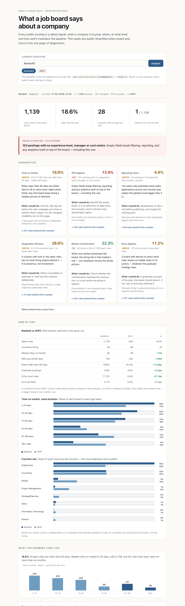

# hiring-signal

A one-page read of any public job board. Point it at a company's SmartRecruiters
identifier and it turns their open postings into diagnostics: time on market,
reposting churn, geographic thinness, ATS hygiene, seniority mix, and how much AI
is actually in the job text rather than in the strategy deck.

Every number comes with the list behind it — open a diagnostic and you get the
actual roles, with links, sorted oldest first. A count you cannot inspect is an
opinion.



**Live:** `https://edembey.github.io/hiring-signal/?company=Ramboll3&vs=AFRY`

No backend, no build step, no dependencies, no API key.

---

## Why

A public job board is a dated, structured record of what a company is buying:
which roles, in which markets, at which level, and how carefully it maintains the
pipeline. Almost nobody reads it that way, because the board is designed to be
read one posting at a time.

This reads all of them at once, and says what it would do about it.

## How it works

Two layers, because the API splits the data:

| Layer | What | Where it runs | Freshness |
| --- | --- | --- | --- |
| Live | ages, countries, business areas, seniority, duplicates, monthly volume, managers, org paths, AI in titles, the drill-down lists | browser, on page load | exact at load time |
| Text | AI mentions in full descriptions, description length, template consistency | `tools/deep.py`, nightly | snapshot ≤ 24 h |

The list endpoint has no job descriptions. Pulling ~1,100 detail endpoints per
company from a visitor's browser would take minutes, so that part is
pre-computed and committed. Everything the headline argument rests on is live.

## Side by side

`?company=Ramboll3&vs=AFRY` adds a comparison block right under the diagnostics.
Both boards are read live in the same run, so there is no pre-baked benchmark to
drift.

- **A table of scalars** — median and p90 days on market, share older than 90
  days, duplicate share, entry-level share, AI in titles — with a signed delta.
  Colour marks which board is ahead on that measure, not which company is better.
- **Time on market, same buckets** — the shape difference is usually the story:
  one board can have a similar median and a much fatter tail.
- **Function mix** — the one breakdown both boards publish.

Deliberately *not* compared: month-on-month volume (both boards republish in
bulk, so the line would show the batch, not the hiring) and any field one of the
boards does not publish — that is reported as not comparable rather than as a
zero.

## Three things it deliberately does not do

**It does not confuse a different schema with bad data.** Companies do not share
a field set. Ramboll publishes a supervisory organisation and a cost centre;
AFRY publishes neither, and a naive comparison would score AFRY at 100% "missing
fields". The tool checks which fields a board actually publishes and reports
`n/a` instead of a false failure.

**It does not pretend percentages mean anything on a small board.** Under 30
postings every rate is noise — 1 of 1 is always 100%. The page says so and drops
the verdict colours.

**It does not trust `releasedDate`.** On the Ramboll board 126 postings share a
single release date, which means the dates were bulk-set. The chart says so
instead of drawing a hiring spike that never happened.

## Run it locally

```bash
python3 -m http.server 8000 --directory docs
open "http://localhost:8000/?company=Ramboll3"
```

`file://` mostly works because the API sends `Access-Control-Allow-Origin: *`,
but ES modules are blocked on `file://`, so use the server.

| URL | State |
| --- | --- |
| `/?company=Ramboll3` | the main report |
| `/?company=Ramboll3&vs=AFRY` | two boards side by side |
| `/?company=AFRY` | different schema — proves the tool is not bespoke |
| `/` | empty state / how to use it |
| `/?company=NoSuchCoXYZ` | not-found state |

Any public SmartRecruiters board works. The identifier is the first segment of a
job URL: `jobs.smartrecruiters.com/Ramboll3/744000151575689` → `Ramboll3`.

The comparison board is whatever you put in `vs=` — both are read live in the
same run, so there is no pre-baked benchmark to drift.

## Refresh the text layer

```bash
python3 tools/deep.py --company Ramboll3 --company AFRY
```

Writes `docs/deep/{company}.json` plus `docs/deep/index.json`, a manifest so the
page does not 404 on boards without a snapshot. Responses are cached in
`tools/cache/`, so a second run only fetches new postings: **about 4–5 minutes
cold for both boards, about 15 seconds warm.**

`.github/workflows/refresh.yml` runs the same command daily at 05:00 UTC, with
`actions/cache` on `tools/cache` so the nightly job does not re-download ~2,000
endpoints from someone else's API. It commits the result, which redeploys the
page.

## Tests

```bash
node --test tests/*.test.js
```

31 tests, no dependencies, no network. `workflow_dispatch` in
`.github/workflows/test.yml` runs them on every push, plus a syntax check of the
Python.

The parser is the risky part, not the fetch. The suite covers the
supervisory-organisation strings that actually appear in the wild: `SOIN9245`
style codes, nested parentheses (`(Ian Lanchbury (Inherited))`), hyphenated
surnames that also get duplicated (`Miguel Granado-Ibáñez- …`), and the 111
records where the field names two different people and the API does not say
which one is current.

## Layout

```
docs/          the page — index.html, app.js, parse.js, metrics.js, charts.js
docs/deep/     pre-computed text layer + manifest
tools/deep.py  the only Python, stdlib, ~4 minutes cold
tests/         node --test
```

Charts are generated as inline SVG at render time from the live payload, and
re-drawn on resize so text stays at real CSS pixel size on a phone. Drill-down
tables are built on first open, not on load — six lists of 200 rows is a lot of
DOM for something most readers never expand.

## Where the thresholds come from

They are judgment calls, not industry benchmarks, and the page says so:

| Signal | Line | Why |
| --- | --- | --- |
| Time on market | >90 days | roughly where a role is either hard to fill or already dead |
| ATS hygiene | 10% / 25% | the share of the board before it changes the story |
| Geographic thinness | ≤2 roles | below this a country has a presence, not a hiring engine |
| Small board | <30 postings | every percentage is noise |

They live in `docs/metrics.js` as plain numbers. Change them there.

## Limits

Stated on the page too, because a report without them is an infographic:

- **No hires, no applications.** A posting is demand, not outcome.
- **Posted date is not first-published date.** Boards get republished in bulk.
- **Duplicate clusters can be legitimate** — several heads on one role look
  identical to a repost.
- **One board is not a market.** The comparison is against another public board,
  not an industry average.
- **Country counts are where roles are open**, not where the company operates.

## Data

Public postings only (`visibility: PUBLIC`), no authentication, no scraping of
the marketing site, no recruiter contacts, no personal data beyond what the
employer publishes in the posting itself. Responses are cached to disk and
rate-limited to four concurrent requests; the page refuses boards above 5,000
postings rather than hammer the API.

Nothing is tracked. The only network calls are to `api.smartrecruiters.com` and
to this repository's own files. The "new since your last visit" line compares
posting ids in `localStorage` — it never leaves the browser.
